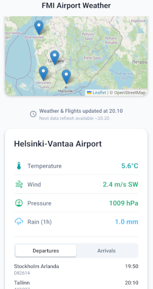
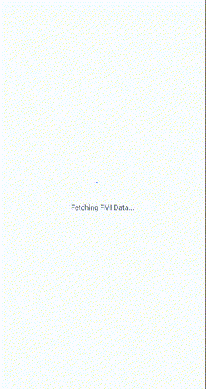

# FMI Airport Weather

<table>
  <tr>
    <td align="center"><br /><sub><b>Screenshot</b></sub></td>
    <td align="center"><br /><sub><b>Demo</b></sub></td>
  </tr>
</table>


## 🌤 Features
- **Real-Time FMI Weather Observations:** Fetches live station data via FMI WFS API (`opendata.fmi.fi`) covering temperature, wind speed & direction, barometric pressure, and 1-hour precipitation with dynamic color-coded metrics.
- **Live Finavia Flight Schedules:** Parses public XML flight feeds (`apigw.finavia.fi`) to display upcoming **Departures** and **Arrivals** for each airport card.
- **Smart Flight Filtering & Sorting:** Automatically filters out older flights using a 30-minute past cutoff and current-day checks, sorted strictly in chronological order.
- **Interactive Leaflet Map:** Custom map integration with smooth multi-directional panning, touch gesture coordination, and automatic card jumping on airport selection.
- **Card-Specific Toggles:** Independent Arrivals/Departures segment controls per airport card.
- **Pull-to-Refresh Sync:** Simultaneous background synchronization for both weather and flight data feeds.

## 📡 API Integration & Architecture
The app pulls live telemetry from the [Finnish Meteorological Institute (FMI) Open Data WFS API](https://en.ilmatieteenlaitos.fi/open-data) and live flight feeds from the Finavia API Gateway.

**Key Technical Implementations:**
- **Payload Optimization (FMI):** The default `fmi::observations::weather::simple` query returns up to 24 hours of data (9,000+ rows), which causes mobile timeouts. The app forces a `starttime` parameter locked to the last 60 minutes to ensure lightning-fast, lightweight payloads.
- **Regex XML Parser (FMI):** Standard React Native DOM parsers struggle with FMI's complex `BsWfs` and `om:OM_Observation` namespace prefixes. The app utilizes a custom Regex-based parsing strategy to extract `ParameterName` and `ParameterValue` directly from the raw XML text string, ensuring 100% reliability.
- **Master Dictionary Distribution (Finavia):** Instead of executing separate network requests per airport card, the app downloads Finavia's master national XML feed once on startup, parses it via `@xmldom/xmldom`, and distributes the parsed flight arrays locally into a fast state dictionary.

## 🛠 Tech Stack
- **Framework:** React Native / Expo Router
- **Map Engine:** `react-native-leaflet-view` (OpenStreetMap)
- **Data Sources:** FMI Open Data API (WFS 2.0) & Finavia Public API
- **XML Parsing (Finavia):** `@xmldom/xmldom`

## Prerequisites
* [Docker Desktop](https://www.docker.com/products/docker-desktop) installed and running.
* **Expo Go** app installed on your physical iOS or Android device (for local development).
* A valid API key from the Finavia API Gateway.
* Both your mobile device and your host computer must be on the same Wi-Fi network.

## 1. Local Development (Expo Go)

This project runs entirely inside a Dockerized Node environment. You do not need Node.js installed on your host machine.

1. Clone the repository and navigate into the folder.
2. Find your computer's local Wi-Fi IP address (e.g., `192.168.1.50`).
3. Export your IP address as an environment variable before starting Docker:
   ```bash
   export MY_WLAN_IP=192.AAA.BB.CCC
   docker compose up
   ```

Once the Metro bundler starts, it will display a QR code in your terminal.

Open the Expo Go app on your phone and scan the QR code to load the app.

Edit src/app/index.tsx on your host machine. The Docker volume will detect the changes and instantly Fast Refresh (Hot-Reload) the app on your phone.

## 2. Building a Standalone Android APK
To build a standalone .apk that runs independently of Expo Go, you will use Expo Application Services (EAS).

### 2.1 Open a shell inside the running container:

  ```bash
   docker compose exec -it expo-app bash
   ```
### 2.2 Set environment variables
   ```bash
   export EXPO_PUBLIC_FINAVIA_API_KEY="your_finavia_api_key_here"
   export EXPO_TOKEN="your_personal_access_token_here"
   ```

### 2.3 Install the EAS CLI and Authenticate
   If you use a standard Expo account with a password, log in interactively:
   ```bash
   npm install -g eas-cli
   eas login
   eas whoami
   ```

### 2.4 Initialize and Trigger the Cloud Build
This will inject a new `projectId` into your `app.json`:
```bash
eas build:configure
```
Because of Docker/Git file ownership mismatches, bypass Git packaging using `EAS_NO_VCS=1`:
```bash
EAS_NO_VCS=1 eas build -p android --profile preview
```
Follow the terminal prompts to generate a new Android Keystore (if needed).

If you want/need to pass tokens to EAS build use
EXPO_TOKEN=your_personal_access_token_here npx eas-cli build -p android --profile preview

### 2.6 Install APK to your device
When the build finishes (~5-10+ minutes depending on the usage load), EAS will provide a link to download the APK. Download it to your host machine and install it via ADB over USB:
```bash
adb install path/to/your-app.apk
```
*(Alternatively, you can scan the provided QR code directly with your Android device).*
